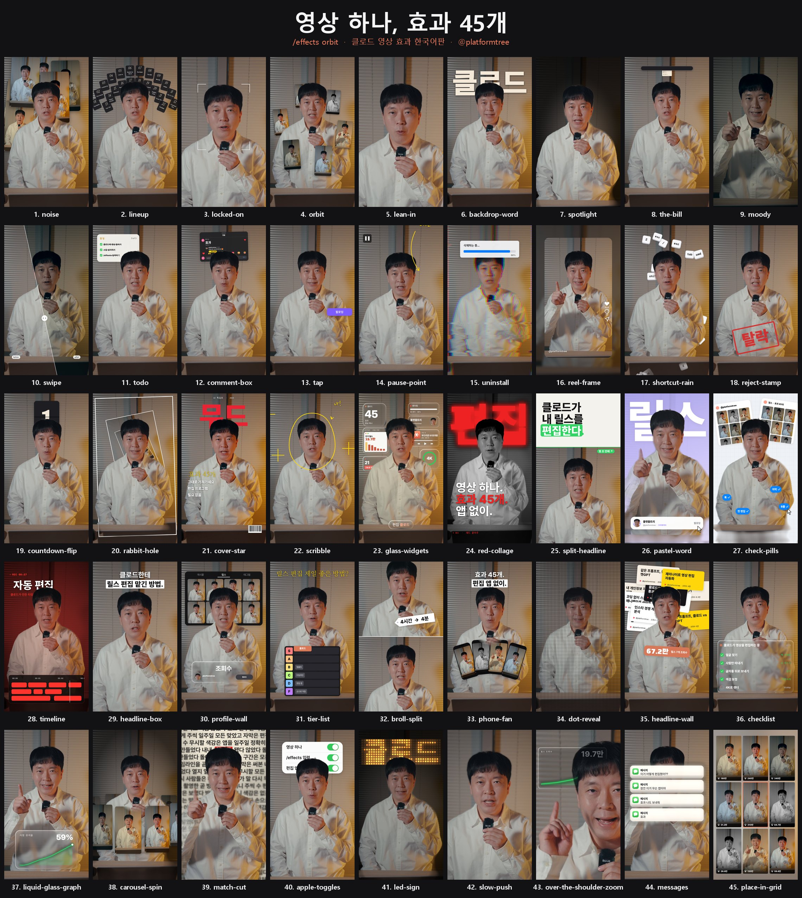

# 클로드 영상 효과 45개 — 한국어판

말하는 영상 하나를 클로드에 올리고 `/effects orbit`처럼 효과 이름만 치면 편집이 끝납니다.

한국어판 정리: 플랫폼트리 [@platformtree](https://instagram.com/platformtree)
원작: [claude-video-effects](https://github.com/Vibha-Ramprakash/claude-video-effects) by Vibha Ramprakash ([@vibha.in.progress](https://instagram.com/vibha.in.progress)) · MIT 라이선스



## 원작과 달라진 점

- **한글이 깨지지 않습니다.** 원작 폰트는 영문 전용이라 한글이 네모(□)로 나왔습니다. 효과마다 어울리는 무료 한글 폰트(프리텐다드, 검은고딕, 나눔명조, 나눔펜, 나눔고딕코딩)를 짝지어 넣었습니다. 영어 글자는 원작 폰트 그대로 나옵니다.
- **한국어로 설명해도 됩니다.** 효과 이름은 원작 그대로 영어(`/effects orbit`)이고, 나머지는 "3초부터", "'불 꺼'라고 말할 때"처럼 한국어로 말하면 됩니다.
- **"이 단어 말할 때"가 한국어로 정확해졌습니다.** 받아쓰기를 한국어로 지정하고 더 정확한 모델로 바꿨습니다.
- **화면 속 문구가 한국어입니다.** 팔로우/팔로잉, 댓글 달기, 게시, 메시지, "클로드가 영상을 편집하는 중" 등.
- **윈도우에서 바로 됩니다.** 설치 스크립트와 이모지 폰트를 윈도우에 맞게 고쳤습니다.

## 설치 (한 줄)

클로드 코드를 열고 아래 문장을 그대로 붙여넣으세요. 클로드가 알아서 설치합니다.

```
github.com/codmsdncodusdn-web/claude-video-effects-ko 스킬을 ~/.claude/skills/effects 에 설치해줘
```

직접 하려면 터미널에 붙여넣으세요.

**맥**
```bash
git clone https://github.com/codmsdncodusdn-web/claude-video-effects-ko ~/.claude/skills/effects
```

**윈도우 (PowerShell)**
```powershell
git clone https://github.com/codmsdncodusdn-web/claude-video-effects-ko $HOME\.claude\skills\effects
```

설치한 뒤 클로드 코드를 다시 켜면 끝입니다.

> 원작 스킬을 이미 같은 폴더(`effects`)에 깔았다면 그 폴더를 지우거나 이름을 바꾼 뒤 설치하세요.

## 쓰는 법

1. 클로드 코드를 엽니다 (앱이든 터미널이든).
2. 영상을 채팅창에 끌어다 놓습니다.
3. 원하는 효과를 칩니다.

```
/effects orbit 3초부터 6초까지
/effects spotlight "불 꺼" 라고 말할 때, 뒤에 클로드 글자
/effects comment-box 마지막에, "효과" 입력
/effects glass-widgets 처음 3초
```

처음 한 번은 클로드가 준비를 합니다(약 2~3분). ffmpeg와 파이썬이 필요한데, 없으면 클로드가 설치해줍니다.

클로드가 먼저 몇 장면을 확인해서 얼굴을 가리는 게 있으면 고치고, 원본 옆에 `영상이름_effects.mp4`를 만들어줍니다. 원래 소리는 그대로 남습니다.

여러 효과를 한 번에 넣을 수도 있습니다.
*"6초부터 10초까지 locked-on, 10초부터 13초까지 orbit, '아니요'라고 할 때 reject-stamp 넣어줘."*

## 효과 45개

| # | 이렇게 치세요 | 어떻게 되나요 |
|---|---|---|
| 1 | `noise` | 머리 뒤로 릴스가 쌓입니다 |
| 2 | `lineup` | 번호 붙은 타일이 머리 위로 부채꼴로 펼쳐집니다 |
| 3 | `locked-on` | 얼굴에 조준선이 붙고 카메라가 따라갑니다 |
| 4 | `orbit` | 내 릴스가 머리 주위를 돕니다 |
| 5 | `lean-in` | 한 단어에서 빠르게 확 당겨집니다 |
| 6 | `backdrop-word` | 커다란 단어가 내 뒤로 떨어집니다 |
| 7 | `spotlight` | 방 불이 꺼지고 나만 밝게 남습니다 |
| 8 | `the-bill` | 내 지시가 영수증처럼 인쇄돼 나옵니다 |
| 9 | `moody` | 분위기 있는 색보정 |
| 10 | `swipe` | 전후 비교 슬라이더가 지나갑니다 |
| 11 | `todo` | 머리 옆 할 일 목록이 말하는 대로 체크됩니다 |
| 12 | `comment-box` | 인스타 댓글이 저절로 입력되고 게시됩니다 |
| 13 | `tap` | 팔로우 버튼이 팔로잉으로 바뀝니다 |
| 14 | `pause-point` | 화면이 멈추고 손글씨 화살표가 나를 가리킵니다 |
| 15 | `uninstall` | 글리치 삭제 막대가 화면을 깹니다 |
| 16 | `reel-frame` | 영상이 릴스 카드로 줄어듭니다 |
| 17 | `shortcut-rain` | 키보드 키가 내 뒤로 비처럼 떨어집니다 |
| 18 | `reject-stamp` | 빨간 도장이 쾅 찍힙니다 |
| 19 | `countdown-flip` | 머리 위 3, 2, 1 플립 시계 |
| 20 | `rabbit-hole` | 방이 터널처럼 빨려 들어갑니다 |
| 21 | `cover-star` | 내가 잡지 표지가 됩니다 |
| 22 | `scribble` | 마커 낙서가 내 주위에 그려집니다 |
| 23 | `glass-widgets` | 유리 위젯과 미니 화면이 머리 주위에 떠다닙니다 |
| 24 | `red-collage` | 흑백의 나, 뒤에 커다란 빨간 단어, 문구 세 줄 |
| 25 | `split-headline` | 제목 카드가 내려오며 나를 아래 절반으로 밉니다 |
| 26 | `pastel-word` | 라벤더 방, 뒤에 큰 단어, 프로필 카드가 팔로우됩니다 |
| 27 | `check-pills` | 모눈종이 방, 뒤에 릴스 보드, 파란 알약이 클릭됩니다 |
| 28 | `timeline` | 붉은 필름 톤에 편집 타임라인과 빛나는 재생 막대 |
| 29 | `headline-box` | 확 당겨지며 두 줄 제목이 나옵니다 |
| 30 | `profile-wall` | 내 릴스 그리드가 벽을 채우고 숫자가 올라갑니다 |
| 31 | `tier-list` | 티어표가 내려오고 클로드가 S티어로 날아갑니다 |
| 32 | `broll-split` | 위에 B롤과 가격표 스티커, 아래에 나 |
| 33 | `phone-fan` | 내 릴스가 폰 카드처럼 부채꼴로 펼쳐집니다 |
| 34 | `dot-reveal` | 빛나는 점들로 화면이 만들어지다 선명해집니다 |
| 35 | `headline-wall` | 내 릴스 제목들이 머리 뒤로 쌓이고 합계가 뜹니다 |
| 36 | `checklist` | 턱 아래 클로드 작업 목록이 하나씩 초록 체크됩니다 |
| 37 | `liquid-glass-graph` | 유리 카드 속 그래프가 오르고 숫자가 올라갑니다 |
| 38 | `carousel-spin` | 내 릴스가 3D 회전목마처럼 나를 돕니다 |
| 39 | `match-cut` | 기사 페이지가 한 단어에 맞춰 바뀝니다 |
| 40 | `apple-toggles` | 아이폰 설정 스위치가 한 줄씩 켜집니다 |
| 41 | `led-sign` | 불이 꺼지고 내 뒤로 LED 전광판 글자가 써집니다 |
| 42 | `slow-push` | 천천히 얼굴로 다가가며 배경이 흐려집니다 |
| 43 | `over-the-shoulder-zoom` | 한쪽 위 모서리로 줌, 유리 그래프, 반대쪽으로 한 번 더 |
| 44 | `messages` | 메시지 알림이 하나씩 쌓입니다 |
| 45 | `place-in-grid` | 내가 3x3 피드 가운데로 줄어들고 주위에 릴스가 채워집니다 |

보너스: `/effects glitter-spotlight` (금빛 스포트라이트), `cover-star look=editorial` (클래식 잡지), `liquid-glass-graph look=bento` (유리 대시보드).

모든 효과는 얼굴을 따라다니고, 얼굴을 가릴 것 같은 건 머리 뒤로 들어갑니다.

## 팁
- 세로로 찍은, 내가 화면에 나오는 영상이 가장 잘 됩니다.
- 타이밍은 말로 하면 됩니다. "'봐보세요'라고 할 때". 정확한 초는 클로드가 찾습니다.
- `orbit`, `noise`, `phone-fan`, `profile-wall`에 내 릴스를 넣고 싶으면 릴스 캡처 폴더를 클로드에게 주세요.
- 그래프·숫자·제목에는 내 실제 숫자를 넣으세요. 클로드에게 알려주면 됩니다. `19.7만`처럼 한국식 단위도 됩니다.
- 이름·계정이 나오는 효과(`glass-widgets`, `pastel-word`, `profile-wall` 등)는 내 이름과 계정을 알려주세요.
- 기본은 1080p입니다. 4K가 필요하면 말하세요 (더 느립니다).

## 솔직하게
- **기본 버전입니다.** 원작자 릴스의 편집과 똑같지는 않습니다. 원작 릴스는 효과음과 손으로 맞춘 타이밍이 더해진 결과입니다.
- 클로드가 초안을 만들고, 올리기 전에 꼭 직접 보세요.
- 효과음과 자막은 넣지 않습니다. 캡컷 같은 앱에서 넣으세요.

## 잘 안 될 때
보이는 그대로 클로드에게 말하세요. "글자가 얼굴을 가려", "너무 빨라". 계획을 고쳐서 다시 만들어줍니다.

## 크레딧
- 원작: [claude-video-effects](https://github.com/Vibha-Ramprakash/claude-video-effects) © 2026 Vibha Ramprakash, MIT
- 얼굴 추적: [OpenCV YuNet](https://github.com/opencv/opencv_zoo) (MIT) · 사람 따내기: [MediaPipe Selfie Segmenter](https://ai.google.dev/edge/mediapipe/solutions/vision/image_segmenter) (Apache 2.0)
- 영문 폰트: Archivo Black, Instrument Serif, Space Mono, Inter, Anton, Montserrat, Playfair Display (SIL OFL), Permanent Marker (Apache 2.0)
- 한글 폰트: Pretendard (길형진, SIL OFL), Black Han Sans · 나눔명조 · 나눔펜 · 나눔고딕코딩 (SIL OFL)
- 라이선스 원문은 `LICENSE`, `fonts/`, `models/NOTICE.md`에 있습니다.
